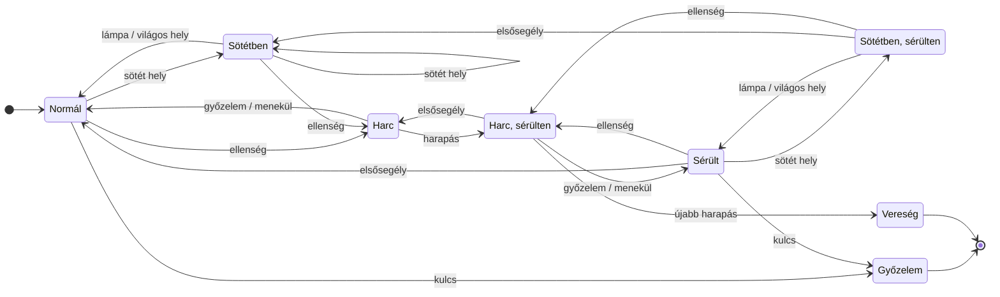
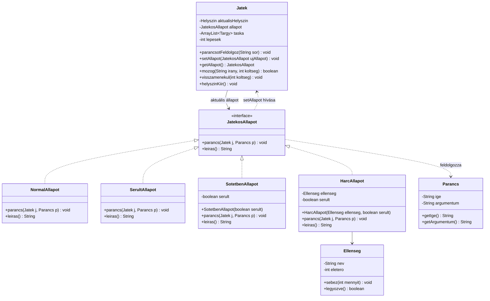

# UML diagramok

A diagramok [Mermaid](https://mermaid.js.org/) formátumban vannak, a GitHub és az IntelliJ Markdown-előnézete
(*Settings → Languages & Frameworks → Markdown → Mermaid*) kirajzolja őket.

## Állapotdiagram

A `SotetbenAllapot` és a `HarcAllapot` egy `serult` jelzőt is tárol, ezért a diagramon mindkettő két változatban
szerepel (sérülten és sérülés nélkül). Így látszik, hogy a sötétség vagy a harc után a játékos a megfelelő
állapotba (Normál vagy Sérült) tér vissza.

| Felirat | Parancs és feltétel |
|---|---|
| sötét hely | `menj <irany>` sötét helyre, és a lámpa nem ég |
| világos hely | `menj <irany>` világos helyre |
| lámpa | `hasznald lampa` (a lámpa onnantól égve marad) |
| ellenség | `menj <irany>` olyan helyre, ahol ellenség van |
| győzelem | ütés, amitől az ellenség életereje 0-ra csökken |
| menekül | `menekul`: visszalépés az előző helyszínre |
| harapás | ütés, de az ellenség még áll, és visszaharap |
| újabb harapás | ugyanez, de a játékos már sérült: **elveszíti a játékot** |
| elsősegély | `hasznald elsosegely` (elhasználódik) |
| kulcs | `hasznald kulcs` a zárt Vizsgaterem melletti helyszínen |

- **Ütés**: `tamad` (1 sebzés) vagy `hasznald seprű` (3 sebzés). Bodrinak 3 életereje van.
- **Időkorlát**: bármelyik állapotban, ha a lépések száma eléri a 30-at, a játék véget ér
  („Elkéstél a vizsgáról!”). Ezt a `Jatek` ellenőrzi minden parancs után.
- **Lépésköltség**: egy mozgás (`menj` vagy `menekul`) Normál és Sötétben állapotban 1 lépés, sérülten 2 lépés.
- A diagramon nem szereplő parancsok (`nezd`, `taska`, `vedd fel`, haszontalan tárgy használata) nem váltanak
  állapotot. Harc közben ezek egyáltalán nem működnek, csak a `tamad`, `menekul` és `hasznald`.
- A `segitseg`, a `kilep` és az ismeretlen parancsokat a `Jatek` maga kezeli, ezek egyik állapottól sem függnek.

## Osztálydiagram – State minta

| State minta szerep | Osztály |
|---|---|
| Context | `Jatek` |
| State | `JatekosAllapot` (interfész) |
| ConcreteState | `NormalAllapot`, `SerultAllapot`, `SotetbenAllapot`, `HarcAllapot` |

A `Jatek` minden játékbeli parancsot továbbad az aktuális állapotnak (`allapot.parancs(this, p)`). Hogy mi lesz a
következő állapot, azt mindig az aktuális állapot dönti el: létrehozza az új állapotobjektumot, és átadja a
`j.setAllapot(...)` hívással. Ezért nincs a kódban egyetlen `if (allapot == ...)` vagy `switch` sem az állapotra.
